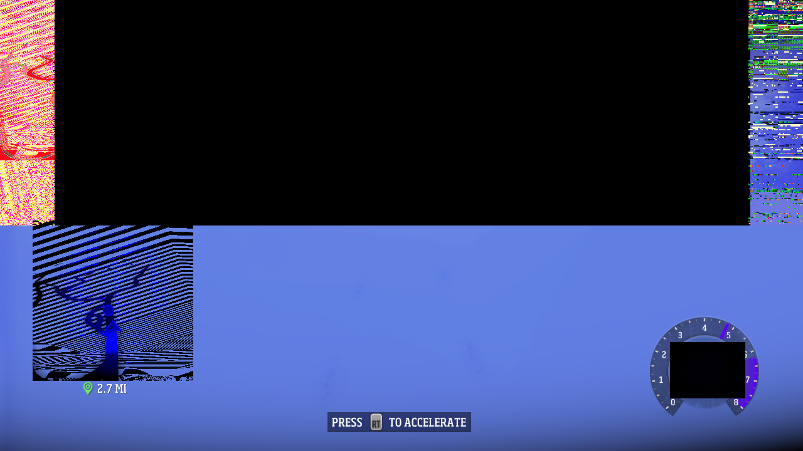
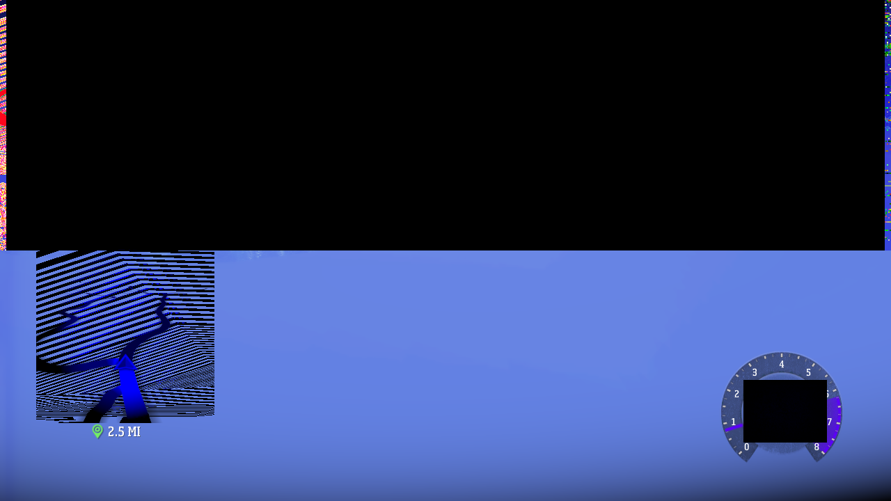
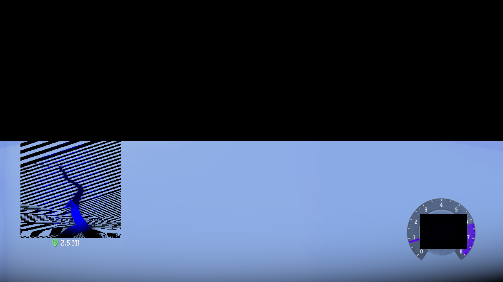

# Render bug — where we're at (2026-11-14)

A full record of the open-world render bug in the D3D11 backend, what has
been ruled out, what has been tried, and where the issue actually lies.
Updated 2026-11-14 ~23:16 CST. No rendering fix yet.

## The bug

Open-world driving in Forza Horizon 1 does not render the world. The screen
is flat blue with a black top half and a thin band of terrain. Roads and
mountains duplicate. The Viper renders blue instead of yellow/black.

What works: menus, cutscenes, automated driving, and the 2D HUD (minimap,
speedometer, "PRESS RT TO ACCELERATE" text) all render fine.

What doesn't: the 3D world in player-controlled open-world driving.

Reproduces identically on the RX 5700 XT and the GTX 570, so it is backend
logic, not Fermi-specific.

## The test captures

All four frames below are from the same scripted free-roam route
(1280x720). The 4x baseline and the 1x MSAA-off test are visually
identical — that is the point.

### 4x MSAA baseline, frame 3600

Black top half, flat blue bottom half, no world. Minimap (2.7 MI),
speedometer, and "PRESS RT TO ACCELERATE" render. "FLYNT" label and a
"SAVING" spinner are visible (2D HUD).

### 1x MSAA-off test, frame 3600

Identical to the 4x baseline. Black top half, flat blue bottom half, no
world. Same minimap (2.7 MI), same speedometer, same "PRESS RT TO
ACCELERATE". Disabling MSAA changed nothing in the picture.

### 1x MSAA-off test, frame 5400

Later in the same route. Still black top, flat blue bottom, no world.
The minimap updated to 2.5 MI, so the game is running and the car is
moving — the 3D world just is not there.

### 4x MSAA baseline, frame 5400

The 4x baseline at the same point in the route, for comparison. Same
broken picture as the 1x test.

## What has been ruled out

- **Presenter / screen copy.** The bad pattern (dark, vertically repeated
  road scene) is already in the native EDRAM surface dump, before the
  composite draw and before the presenter. It is not a bad screen copy.
- **Colour swap.** R/B correlation is +0.974 and both swap flags are
  correctly off. The blue is not a channel swap; the world pixels are
  simply missing/wrong.
- **Present-device / shared-texture path.** That fix chased a session-0
  fake-display artifact and was reverted 2026-11-13. Do not resume it.
  The current path is CPU readback, which works (loading screen renders).
- **Dump writer.** `DumpTextureBmp` is not broken — the "1,638-byte" claim
  was disproven (files are full-size) and retracted.
- **VRAM.** ~800 MB used on the GTX 570. Not a capacity problem.
- **MSAA.** The 1x test (below) proves MSAA is not the problem. MSAA is
  just affected — it is where the bug shows up, not the cause.
- **Surface selection (owner-split).** The owner-split fix populated the
  4x sources but did not fix the image, and was backed out (below).

## The investigation, in order

### 1. The repeated resolve rect (2026-11-14 ~22:30 CST)

The 720-row scene texture is assembled by three consecutive 4x MSAA
resolves from the same source (`0/32/4x/c12`):

- rect `[0,0,1280,256]`, sample_select 6
- rect `[0,0,1280,256]`, sample_select 6
- rect `[0,0,1280,208]`, sample_select 6

All three read from the top of the source (row 0) instead of rows 0, 256,
and 512. The source surface holds only ~256 rows of scene in a 512-row
target. The scene texture at guest address `0x1C4E1000` is byte-identical
between guest and GPU mirror, so the data is not corrupted in transit.

### 2. The correction — the rect does not prove repeated pixels

At frame 338, the audit shows all three resolves read from the same EDRAM
surface and the tiles have one owner. But between resolves, the game
redraws into that surface with window offsets of 0, -256, and -512. So
the repeated source rectangle does NOT prove the same pixels were copied
each time — the surface content may differ per resolve because of the
redraws. The earlier conclusion ("the same 256 rows repeat 3x") was too
strong. The captured rows show data reaching the resolve output, but do
not show whether the right colour values reach each destination chunk.

### 3. The owner-split fix (2026-11-14 ~22:32–22:40 CST) — tried, backed out

D3D12 and Vulkan split a resolve rectangle by EDRAM tile owner and resolve
each owned piece from its actual surface. D3D11 picked one source surface
for the whole rectangle. The code itself labelled per-owner splitting as
"unfinished" in D3D11.

Codex implemented the owner-split (wired `Fh1EdramTiles`, 3 files edited).
Build verified: `rexgpu-fh1.dll` 11,135,488 B. It populated the 4x sources
(964/1280 sampled texels nonzero vs 0–4 before), but the image did not
change — the bands were still repeated. **The owner-split was backed out
(reverted). It is not in the current build.** Commit `bda840e` on this repo
still contains it; the repo is out of sync with the current build on that
point.

### 4. The MSAA-off test (2026-11-14 ~22:56–23:02 CST) — MSAA is not the problem

Seth's call: remove MSAA for a quick test. If 1x fixes it, MSAA was the
problem; if 1x is still broken, MSAA was not the problem.

There was no existing switch to disable the game's 4x mode
(`native_2x_msaa` only controls 2x handling). Codex added a reversible,
restart-required D3D11 diagnostic override at `RB_SURFACE_INFO` writes so
the whole renderer sees 1x consistently, without changing the saved
configuration. Build succeeded. The test launcher first failed on a
restricted Windows sandbox temp folder; rerun with temp files redirected
into the project's writable workspace.

Result: the runtime log confirms the D3D11 FH1 surfaces were created at
1x. The world was still fragmented — the 1x frames above are identical
to the 4x baseline. **MSAA alone does not explain the rendering failure.**

Caveat (Codex): the test missed its timing gate, and 1x changed surface
dimensions, so it is not a clean same-state A/B comparison. The frames
above are nonetheless visually identical, which is the decisive evidence.

MSAA was restored to the normal 4x default and rebuilt. The 1x diagnostic
is opt-in: `flags.cpp` (line 19); its bulk-register handling is in
`command_processor.cpp` (line 860).

Separately, 4x MSAA uses ~3.1x more memory than 1x — a real cost on the
GTX 570's 1.28 GB VRAM. Disabling MSAA is still a win on memory even
though it is not the render fix.

## Where the issue lies

**Upstream, in the draws / EDRAM surface — before the resolve.**

The bad pattern is already in the native EDRAM surface before the resolve
happens. The resolve, MSAA, and surface selection are all downstream of
the real problem (or just where it shows up). The world draws are not
putting the world into the EDRAM surface correctly, or the surface content
is wrong before the resolve.

## Next steps

1. Trace the draws between the three resolves (do not change the resolve
   addresses yet).
2. Capture the source values immediately before each resolve, compare them
   with the corresponding guest-memory chunk.
3. If those match, trace the compositor. That should identify the failing
   step before another code change.

## Separate plan: FSR 1 for the GTX 570

After the world renders correctly, add FSR 1 (FidelityFX Super Resolution
1.0, EASU + RCAS spatial upscaler) to the backend to compensate for losing
MSAA. FSR 1 is open source (MIT), its shaders compile and run on DirectX
11, and FL 11_0 has Compute Shader 5.0. Render at a lower internal
resolution, upscale to display res with edge reconstruction. This is image
quality + performance, not the render fix. Shader pack + integration sketch
are staged locally (`~/workspace/fsr1-gtx570/`).

## Evidence and references

- Frame-338 audit (repeated rect, single owner, redraw window offsets
  0 / -256 / -512).
- Audit captures: `d3d11-passes-20261115-033805.jsonl` (frames 2400–2402,
  menu), `d3d11-passes-20261115-044431.jsonl` (frame 300, 4x sources
  populated after owner-split: 964/1280 nonzero).
- Test captures: `codex-d3d11-band-route-20261115T0412Z` (4x baseline,
  frames 3600/4200/4800/5400) and
  `codex-d3d11-msaa-off-retry-20261115` (1x test, frames 3600/4200/4800/5400).
- Provenance probe: `EnumerateResolveOwners` in `fh1_native_executor.cpp`
  / `.h` (verified in `rexgpu-fh1.dll`); per-owner probe loop in
  `command_processor.cpp`; `PassWindowActive()` gating in `render_audit.h`.
- Commits: `e4df15d81dc9` (D3D11 source upload), `bda840e` (42 files incl.
  owner-split + provenance + gating + headers — note: owner-split has
  since been backed out of the build), `49a4a03` (README update).

## Config (at time of writing)

- `gpu_backend="d3d11"`, `d3d11_adapter="5700 XT"` (renderer on the 5700 XT
  since 2026-11-14 ~20:33; fix there, then verify back on the GTX 570).
- `pinyon_audit=true`, `pinyon_audit_passes=true`,
  `pinyon_msaa_probe=true`, `pinyon_dump_frames=true`.
- Audit window was `[2400, 2402]` (menu); gameplay starts ~frame 3000.
- Audit black screen persists on the GTX 570 cross-adapter present path
  even with gating; audit-off restores display. Cause unknown.
- FPS: 8.0–17.7 in free-roam (workload streaming, single CPU decoder
  thread bottleneck, not a code regression). 30 FPS at 720p is the
  realistic target.
